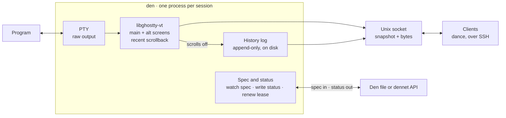

# den — PRD

Started Nov 3, 2026 by Marko Mikulicic as a PDF; moved into the repo so it can
change along with the code. When the code and this document disagree on purpose,
update this document in the same PR.

## Summary and goals

den is a small Zig process that owns one background program and its PTY, keeps its full
terminal history, and lets clients attach and detach without losing anything. It does what
zmx does for one session, plus correct history across the alternate screen and history on
disk.

den is the bottom layer of three separate projects:

- **den** (this doc): one process per session, holding the PTY.
- **dennet**: a Go binary embedding a Kubernetes-style API server with its own built-in
  types and controllers, connecting many dens.
- **dance**: the frontend that lets a user reach dens on local and remote machines.

### The problem with zmx

zmx loses main-screen history when you detach inside an alternate-screen program like
vim, reattach, then quit it. Its attach snapshot only carries the active screen
(zmx#297). It also keeps all history in
memory, so it is bounded and lost if the daemon dies.

### Goals

- Survive detach, reattach and alternate-screen switches with no lost history.
- Keep den's memory small and roughly flat, however long the session runs.
- Keep complete history on disk, readable after a crash and by other tools.
- Be driven entirely by a declarative `Den` resource, from a file or an HTTP endpoint.
  The CLI is small and kubectl-shaped (`den apply|attach|get|logs|send|delete -f …`);
  it never takes settings that belong in the resource.
- Stay narrow: one session, one PTY, nothing about other dens or hosts.

## Architecture

den is one Zig process per session. The program only ever sees its PTY; the emulator,
history log, control socket and backend client all live inside den.



PTY output feeds libghostty-vt, which holds both screens and recent scrollback. Lines
that scroll off the main screen go to the on-disk log. Clients get a snapshot from both,
then live bytes, through the Unix socket.

## The Den resource

den is configured by one object shaped like a Kubernetes resource: kind `Den` in API group
`den.mkm.pub`, version `v1alpha1`. The same shape is used whether it comes from a file or
from dennet, so den needs no special case for either.

```yaml
apiVersion: den.mkm.pub/v1alpha1
kind: Den
metadata:
  name: build
  namespace: myproject
  uid: 7c1e9a0e-1f2b-4c7d-9a1e-2b3c4d5e6f70
spec:
  command: ["/bin/zsh", "-l"]
  workingDir: /home/marko/src/myproject
  env:
  - name: FOO
    value: bar
  inheritEnv: ["LANG", "LC_*", "SSH_AUTH_SOCK"]  # copied from the environment of `den apply`
  size: {cols: 120, rows: 40}     # used while no client is attached
  paused: false                   # SIGSTOP / SIGCONT
  history:
    memoryLines: 5000             # scrollback kept in libghostty-vt
    keepAfterExit: 24h
  report:                         # which status fields to publish
    fields: [title, cwd, screen, clients]
    interval: 5s
status:
  phase: Running                  # Pending | Running | Exited | Failed
  pid: 41233
  host: lap-mkm
  socket: /run/user/1000/den/build.sock
  clients: 1
  screen: alternate               # main | alternate
  title: vim main.zig
  cwd: /home/marko/src/myproject
  lastOutputTime: "2026-11-03T10:12:44Z"
  exitCode: null
  observedGeneration: 3
```

Rules:

- `spec` is written by whoever creates the Den. `status` is written only by den.
- `metadata.uid` identifies this incarnation. Every status write is conditional on it, so a
  den left over from a deleted object cannot write onto a new one with the same name.
- `status.observedGeneration` tells readers which spec version den has applied.

## Config and status backends

den reads its spec from a URL given with `-f`; the scheme picks the backend. The status
location follows from it: the spec URL with `/status` added to the path, like a Kubernetes
status subresource.

| Scheme | Spec (read) | Status (write) |
|---|---|---|
| a path or `file:///path/den.yaml` | Read and parse the file | Write `status` to a sibling file, atomically via temp file and rename |
| `http://host:port/apis/den.mkm.pub/v1alpha1/namespaces/ns/dens/name` | `GET` the object | `PATCH` the `/status` subresource |
| `http+unix://%2Frun%2Fdennet.sock/apis/…/dens/name`, or `http://…` with `--unix-socket /run/dennet.sock` | Same, over a Unix socket | Same, over a Unix socket |

### HTTP details

- A hand-written HTTP/1.1 client in Zig: `GET`, merge `PATCH`, chunked responses for
  watch. No Kubernetes client library.
- Bearer token from a file, re-read on each request so it can be rotated.
- Status writes use a JSON merge patch on `/status` with a `metadata.uid`
  precondition. A `409` or `404` means the object was replaced or deleted, and den stops
  writing.
- Writes happen only when a reported field changes, batched to at most one per
  `report.interval`.

### Liveness

- **HTTP**: den creates and renews a `coordination.k8s.io/v1` `Lease` with the same
  name and namespace, with an owner reference to the Den so it is cleaned up on delete.
  Renewal every 10 s, duration 30 s, by server-side apply. den only does this when the
  server's discovery (`GET /apis/coordination.k8s.io/v1`) lists `leases`, and stops
  when a status write says the Den is gone.
- **File**: den touches a heartbeat file next to the status file on the same schedule.

Liveness is kept separate from status so a quiet session never writes status just to prove
it is alive.

## Watching for changes

den re-reads its spec whenever it changes, and applies what it can without restarting the
program.

### File backend

- Native OS events: inotify on Linux, kqueue on macOS. Watch the parent directory, not
  the file, so editors that save by rename are caught.
- Debounce bursts (about 100 ms), then re-read and parse. A file that fails to parse is
  ignored and reported in status; the last good spec stays in effect.
- File deleted means the Den was deleted.

### HTTP backend

- A single-object watch: `GET …/dens?watch=true&fieldSelector=metadata.name=<name>&resourceVersion=<rv>`,
  reading newline-delimited JSON events from a chunked response.
- `ADDED` and `MODIFIED` replace the spec. `DELETED` means the Den was deleted. `ERROR`
  with `410 Gone` means re-`GET` and watch again from the new version.
- On any disconnect, back off (1 s up to 30 s) and resume from the last seen
  `resourceVersion`. The program keeps running throughout; an unreachable server only
  pauses status updates.

### What changes apply live

| Field | Effect of a change |
|---|---|
| `size` | Resize the PTY and the emulator, only while no client is attached |
| `paused` | Send SIGSTOP or SIGCONT |
| `history.*` | Apply on the next scrollback trim or log rotation |
| `report.*` | Apply on the next status write |
| `command`, `workingDir`, `env`, `inheritEnv` | Ignored for the running process, noted in status; take effect only if the Den is recreated |
| Deletion | Graceful stop (below), then den exits |

## History and screen state

den keeps recent history in libghostty-vt and all history on disk. Lines are written to disk
the moment they scroll off the top of the main screen, because from then on the program
can no longer change them.

### Two tiers

- **Memory**: libghostty-vt holds the main screen, the alternate screen, and the last
  `history.memoryLines` lines of scrollback (default 5,000). That window lets the
  emulator reflow recent history on resize, the same way the attached terminal does, so
  den's copy stays in sync with what the program thinks is on screen.
- **Disk**: an append-only log of every line that has left the main screen. It is the canonical,
  complete history and survives den crashes.

This keeps den's memory roughly flat. Spinners and progress bars cost nothing extra: they
only reach the log once, in their final state, when their line scrolls away.

### Log format

- One record per logical line, not per screen row. Soft-wrapped rows are joined, so
  history can reflow to any width on replay.
- Each record keeps its text and styling (colours, attributes, hyperlinks), plus a
  timestamp and a sequence number.
- Files rotate by size. A small index maps sequence numbers to file offsets so a client can
  ask for "history from line N".
- A long line is only written once all of its rows have left the screen.

### Alternate screen

While a program is on the alternate screen, the main screen and its scrollback stay
untouched in the emulator. Nothing on the alternate screen is logged: it has no scrollback
by design. This is the case zmx gets wrong, and den gets right simply by always
snapshotting both screens.

### Clears

- Erase screen (Ctrl-L, `ESC[2J`): the visible lines are pushed into scrollback and logged,
  as tmux and screen do.
- Erase scrollback (`clear`, `ESC[3J`): the emulator honours it, so what you see matches.
  The disk log is never truncated; den appends a clear marker instead. Replay stops at
  the last marker by default, and can go past it on request.

## Control socket protocol

Each den listens on one Unix socket, `$XDG_RUNTIME_DIR/den/<namespace>/<name>.sock`,
mode 0600. It is the only way to talk to a running den. Remote access is someone else's
job: dance or dennet can pipe the socket over SSH stdio, so den never does network
authentication.

The protocol is length-prefixed binary frames. Output is tagged with a byte offset into the
PTY output stream, so every client knows exactly where it is.

### Attach: snapshot, then raw stream

1. The client sends `attach` with its size and whether it wants to write or only watch.
2. den sends a **snapshot**: both screens, cursor, modes, and the in-memory scrollback, as
   of stream offset N. Older history is not sent unless asked for.
3. den sends **raw PTY bytes** from offset N onward, exactly as the program wrote them.

This is the same shape Rex uses: the server absorbs all the redraw churn and hands a new
client only the effective state, then streams live.

**Snapshot encoding.** Version 1 encodes the snapshot as VT escape sequences any
terminal can play back: main-screen scrollback and screen first, then switch into the
alternate screen and draw it if it is active. A later version can send libghostty-vt's internal
state directly to Ghostty-based clients, skipping the re-render.

**Falling behind.** Each client has a bounded send buffer. A client that falls too far behind
gets its backlog dropped and a fresh snapshot at the current offset, rather than replaying
minutes of output.

### Messages

| Message | Direction | Purpose |
|---|---|---|
| `attach` | client → den | Start a session: size, read-write or watch-only |
| `snapshot` | den → client | Full effective state at offset N |
| `output` | den → client | Raw PTY bytes from an offset |
| `input` | client → den | Bytes to write to the PTY |
| `resize` | client → den | New size; den resizes PTY and emulator together |
| `signal` | client → den | Send a signal to the program's process group |
| `history` | client → den | Request logged lines in a range, streamed back |
| `detach` | either | End the session; the program keeps running |
| `event` | den → client | Status changes: title, cwd, screen switch, exit |

Only one read-write client types at a time; watch-only clients are unlimited. When several
clients attach with different sizes, the most recent read-write client sets the size.

## Lifecycle and failure modes

- **Start**: den detaches into its own session (`setsid`), so restarting or upgrading
  whatever spawned it never kills the program. It loads the spec, forks the program on a
  new PTY, opens the socket, and reports `Running`.
- **Program exits**: den records the exit code, reports `Exited`, keeps the socket and
  history open for `history.keepAfterExit`, then exits.
- **Den deleted**: send SIGHUP to the program's process group, wait 5 s, then SIGKILL.
  Flush the log, write a final status if still allowed, exit.
- **den killed or crashed**: the program loses its PTY and usually dies. History up to the last
  flushed line is on disk. Handing a live PTY to a new den is out of scope for now.
- **Backend unreachable**: the program keeps running; den retries status and watch with
  backoff and catches up when the backend returns.

## Out of scope

- A CLI beyond the kubectl-shaped commands above.
- Listing, naming or discovering other dens.
- Windows, panes, tabs or any layout.
- Network listeners and authentication beyond Unix socket permissions.
- A Kubernetes client library; only the few HTTP calls above.
- Restarting the program on exit; that is a dennet decision.

## Open questions

- Exact on-disk record format: a custom compact binary, or something existing (CBOR,
  length-prefixed JSON)?
- How long to keep logs after a Den is deleted, and who deletes them?
- Whether the native libghostty-vt snapshot for Ghostty clients is worth doing in v1.
- How dennet authenticates den over HTTP: one shared token per host, or one per Den?
- macOS: confirm kqueue directory watching is enough, or use FSEvents.
- `report.interval` in the spec vs the `--status-interval` flag: the code currently takes
  the flag. Pick one.

## Milestones

1. PTY + libghostty-vt + Unix socket attach and detach, with the both-screens snapshot.
   Fixes the zmx bug.
2. On-disk history log, memory trim, `history` requests and clear markers.
3. `Den` resource from a file, status file, heartbeat, live file watch.
4. HTTP backend over TCP and Unix socket: GET, watch, status PATCH, Lease.
5. Slow-client snapshot catch-up and watch-only clients.
